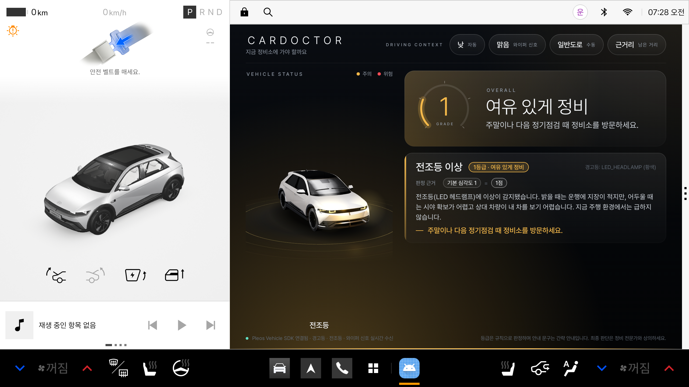
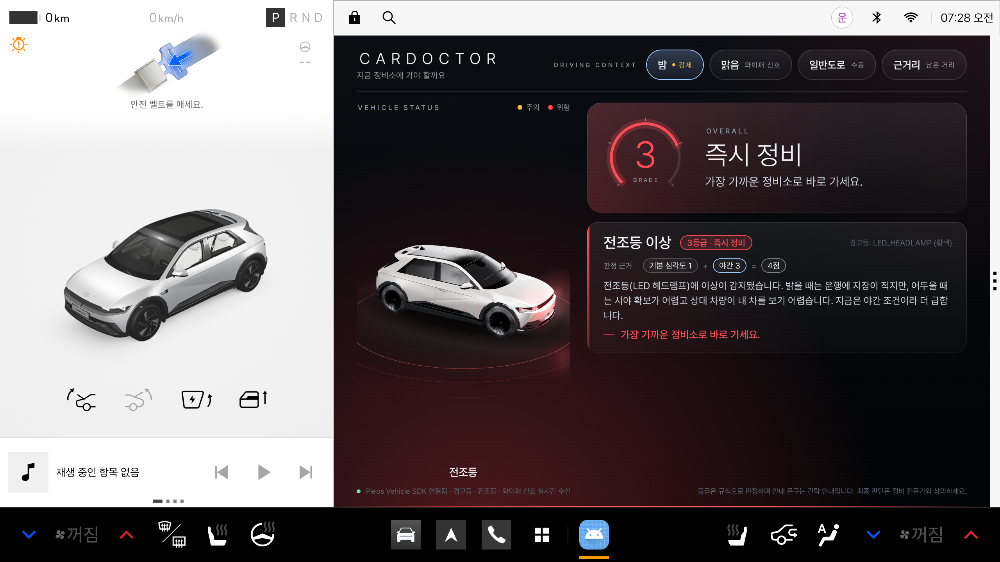
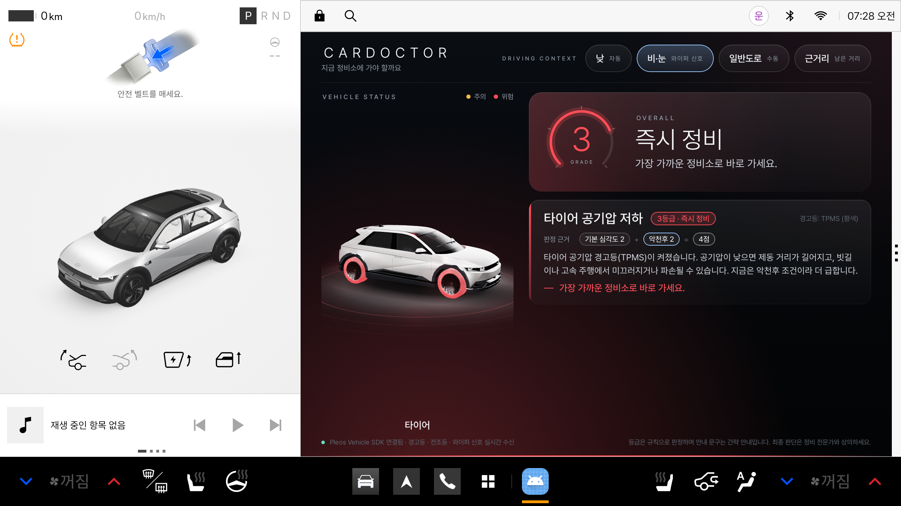

# 카닥터 데모 (Pleos Connect)

차량 경고등을 읽어 **"지금 정비소에 가야 하는지"** 를 4단계로 알려주는 최소 데모 앱입니다.
Pleos Vehicle SDK 2.3.2로 신호를 읽고, 규칙 기반 엔진이 고장의 기본 심각도와 주행 환경을 합쳐 등급을 정합니다.

| 낮, 전조등 이상 → 1등급 | 밤, 같은 고장 → 3등급 |
|---|---|
|  |  |

| 비 오는 날 타이어 공기압 → 3등급 | 브레이크 + ABS → 4등급 |
|---|---|
|  |  |

## 동작 방식

```text
Pleos Vehicle SDK ──▶ PleosSignalSource ──▶ FaultDetector ──▶ SeverityEngine ──▶ 화면
 경고등·전조등·와이퍼     1초마다 읽기          신호 → 고장       심각도 + 환경 → 등급
```

- **긴급도 점수** = 기본 심각도(1~3) + 환경 가중치 합계
- **등급**: 6점 이상 4등급(즉시 정차), 4~5점 3등급(즉시 정비), 2~3점 2등급(목적지 후 정비), 1점 1등급(여유 있게 정비)
- **등급 바닥**: 안전 핵심 고장은 환경과 관계없이 최소 등급을 보장합니다 (과열 3등급, 브레이크+ABS 4등급 등).
- **주차 브레이크 선확인**: 브레이크 경고등만 켜져 있으면 고장이 아니라 "주차 브레이크 확인" 안내로 처리합니다.
- 등급은 규칙으로만 정합니다. 화면의 설명 문구는 규칙표에 들어 있는 고정 문구이며 LLM은 아직 연결하지 않았습니다.

| 환경 | 판단 방법 | 적용 부품군 · 가중치 |
|---|---|---|
| 야간 | 시스템 시각 18~06시, 또는 화면 칩으로 강제 | 등화 +3 |
| 악천후 | 앞 와이퍼 작동 중이면 비로 추정, 또는 강제 | 와이퍼 +3, 타이어·제동 +2 |
| 고속도로 | 화면 칩(수동) | 타이어·제동·조향 +1 |
| 남은 거리 50km 이상 | 화면 칩(수동) | 냉각·구동 +1 |

규칙표는 `app/src/main/java/com/cardoctor/demo/engine/Rules.kt` 에 있습니다. `// 초안` 표시가 있는 항목은 팀 검토가 필요합니다.

## 실행

요구 사항: JDK 17, Android SDK Platform 35, Pleos Connect v2.1 에뮬레이터(Android 14).

```bash
./gradlew testDebugUnitTest      # 판정 엔진 단위 테스트
./gradlew installDebug           # 에뮬레이터에 설치
adb shell am start -n com.cardoctor.demo/.MainActivity
```

## 시연 시나리오

에뮬레이터의 Virtual Console(포트 8088)에 고장을 주입합니다.

```bash
scripts/demo.sh headlamp    # 전조등 이상. 낮 1등급 → 앱에서 '낮' 칩을 눌러 '밤'으로 바꾸면 3등급
scripts/demo.sh tire-rain   # 타이어 공기압 경고 + 와이퍼 작동(비) → 3등급
scripts/demo.sh brake       # 브레이크 + ABS 동시 점등 → 4등급
scripts/demo.sh overheat    # 과열 경고 → 환경과 관계없이 3등급
scripts/demo.sh battery     # 저전압 배터리 경고 → 3등급
scripts/demo.sh steering    # 조향 보조(MDPS) 경고 → 3등급
scripts/demo.sh airbag      # 에어백 경고 → 2등급
scripts/demo.sh clear       # 원상 복구
```

## 디자인

쇼룸의 은색 차량과 앰비언트 라이트를 콘셉트로 했습니다. 피아노 블랙 배경 위에 유리 질감 패널을 얹고,
종합 등급에 따라 화면 전체의 조명 색이 바뀝니다(정상 청록, 주의 호박색, 위험 적색). 4등급은 다이얼과 해당 부위가 점멸합니다.
색과 서체 정의는 `ui/Palette.kt`, 차량 그림은 `ui/CarDiagram.kt` 에 있습니다.

차량은 3D 뷰어로 표시합니다(`ui/Car3DView.kt`, `app/src/main/assets/car3d/`). 천천히 자동 회전하며 드래그로 돌려 볼 수 있습니다.
고장이 감지되면 해당 부위가 등급 색으로 빛나고 카메라가 그 부위 쪽으로 돌아갑니다. 타이어·휠·전조등은 모델의 실제 메시가 빛나고,
모델에 별도 메시가 없는 부위(와이퍼, 구동·냉각, 배터리, 실내, 조향)는 해당 위치의 발광으로 표시합니다.
WebGL이나 모델을 불러올 수 없는 환경에서는 2D 평면도(`ui/CarDiagram.kt`)로 대체됩니다.

## 크레딧과 라이선스

- 차량 3D 모델: This work is based on "Hyundai Ioniq 5 - Lowpoly"
  (https://sketchfab.com/3d-models/hyundai-ioniq-5-lowpoly-675e78311e8440d88714bd212cb7a8fb)
  by andikapratamaw (https://sketchfab.com/andikapratamaw) licensed under CC-BY-4.0
  (http://creativecommons.org/licenses/by/4.0/). 도장 재질을 조정하고 고장 표시용 발광을 추가했습니다.
  원본 라이선스 파일은 `app/src/main/assets/car3d/ioniq5/license.txt` 에 있습니다.
- 렌더링: [three.js](https://threejs.org) r160, MIT License.
- 서체: [Pretendard](https://github.com/orioncactus/pretendard), SIL Open Font License 1.1.

## 알려진 제약

- 경고등 읽기(`Safety.getTelltalesInfo`)는 `pleos.car.permission.PRIVATE_CAR_SAFETY` 권한이 필요합니다. 에뮬레이터에서는 선언만으로 부여되지만, 실차와 공모전 규정에서 허용되는지는 확인이 필요합니다.
- 타이어 실측 공기압은 SDK로 읽을 수 없어 TPMS 경고등만 사용합니다. 어느 바퀴인지는 구분하지 못합니다.
- LLM 설명, 음성 안내, 정비소 연결은 포함하지 않았습니다.
- 속도·도로 종류·날씨 API는 연결하지 않았습니다. 고속도로와 남은 거리는 수동 칩으로만 바꿉니다.
- 에뮬레이터 기준으로만 검증했습니다.
