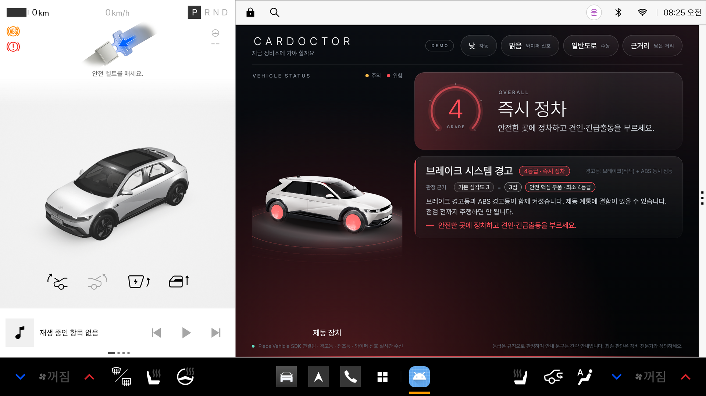
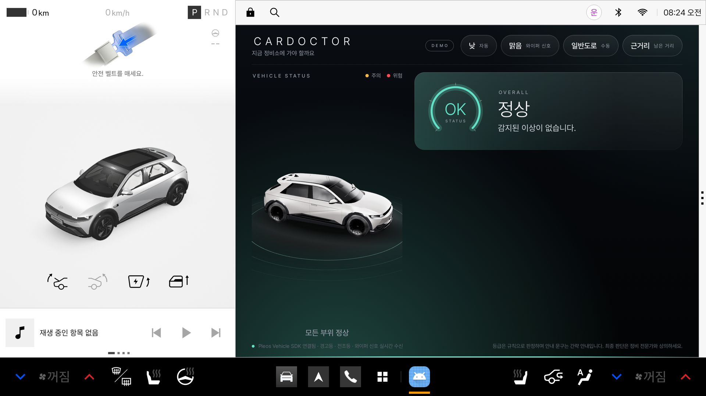
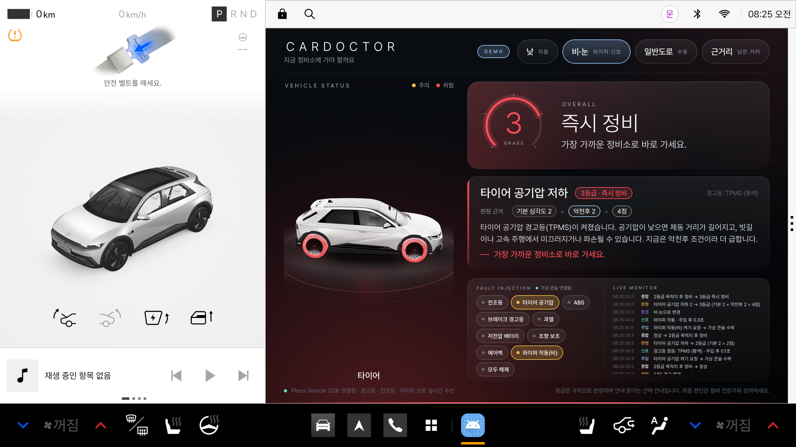
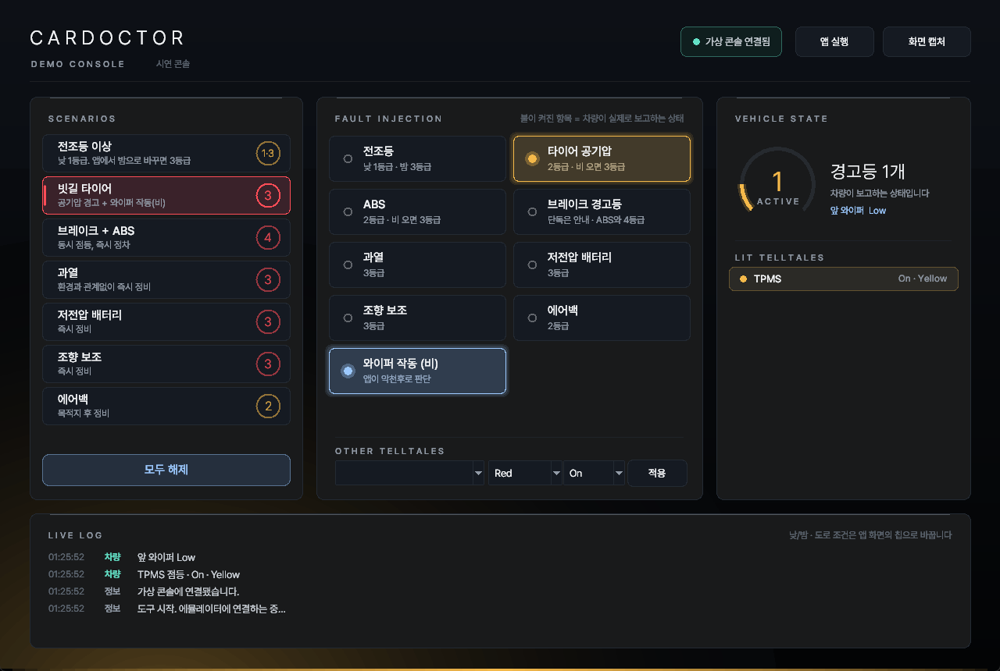

# 카닥터 데모 (Pleos Connect)

차량 경고등을 읽어 **"지금 정비소에 가야 하는지"** 를 4단계로 알려주는 데모 앱입니다.
Pleos Vehicle SDK 2.3.2로 신호를 읽고, 규칙 기반 엔진이 고장의 기본 심각도와 주행 환경을 합쳐 등급을 정합니다.

| 낮, 전조등 이상 → 1등급 | 밤, 같은 고장 → 3등급 |
|---|---|
|  |  |

| 비 오는 날 타이어 공기압 → 3등급 | 브레이크 + ABS → 4등급 |
|---|---|
|  |  |

## 목차

- [빠른 시작](#빠른-시작)
- [앱 사용 방법](#앱-사용-방법)
- [고장 주입 방법](#고장-주입-방법)
- [시연 순서 예시](#시연-순서-예시)
- [동작 방식](#동작-방식)
- [프로젝트 구조](#프로젝트-구조)
- [디자인](#디자인)
- [크레딧과 라이선스](#크레딧과-라이선스)
- [알려진 제약](#알려진-제약)

## 빠른 시작

### 준비물

| 항목 | 버전 | 비고 |
|---|---|---|
| JDK | 17 | `JAVA_HOME` 이 JDK 17을 가리켜야 합니다 |
| Android SDK | Platform 35, Build-Tools 35 | `local.properties` 에 `sdk.dir=<SDK 경로>` 를 적거나 `ANDROID_HOME` 을 설정합니다 |
| Pleos Connect 에뮬레이터 | v2.1 (Android 14) | 일반 Android 기기에는 Pleos Vehicle Service가 없어 차량 신호를 읽을 수 없습니다 |
| Python | 3.9 이상 | GUI 시연 콘솔을 쓸 때만 필요합니다. 추가 패키지는 필요 없습니다 |

### 1. 에뮬레이터 실행

Pleos Connect AVD를 **콜드 부팅**으로 띄웁니다. 빠른 부팅(스냅샷)으로 띄우면 차량 신호가 동작하지 않습니다.

```
emulator -avd Pleos_Connect_v2_1 -no-snapshot
```

`emulator` 는 Android SDK의 `emulator` 폴더에 있습니다. AVD 이름은 `emulator -list-avds` 로 확인합니다.

### 2. 빌드와 설치

저장소 폴더에서 실행합니다. Windows `cmd` 에서는 `./gradlew` 대신 `gradlew` 를 씁니다.

```bash
./gradlew installDebug
```

### 3. 앱 실행

에뮬레이터의 앱 목록에서 **카닥터**를 누르거나 아래 명령을 실행합니다.

```bash
adb shell am start -n com.cardoctor.demo/.MainActivity
```

화면 아래에 "Pleos Vehicle SDK 연결됨"이 보이고 종합 판정이 "정상"이면 준비가 끝난 것입니다.

### 4. 테스트 (선택)

```bash
./gradlew testDebugUnitTest
```

판정 엔진의 단위 테스트 13개를 실행합니다. 에뮬레이터 없이도 돌아갑니다.

## 앱 사용 방법



| 영역 | 내용 |
|---|---|
| 왼쪽 **VEHICLE STATUS** | 3D 차량. 천천히 자동 회전하고, 드래그하면 직접 돌려 볼 수 있습니다. 고장이 감지되면 그 부위가 등급 색으로 빛나고 카메라가 그쪽으로 돌아갑니다 |
| 오른쪽 위 **OVERALL** | 종합 등급과 지금 할 일. 다이얼이 등급만큼 채워지고 4등급은 점멸합니다 |
| 오른쪽 아래 **고장 카드** | 고장마다 등급, 판정 근거(기본 심각도 + 환경 가중치 = 점수), 설명, 할 일 |
| 위쪽 **주행 환경 칩** | 판정에 반영되는 환경. 눌러서 바꿀 수 있습니다 |
| 맨 아래 | 차량 서비스 연결 상태 |

### 주행 환경 칩

같은 고장도 환경에 따라 등급이 달라집니다. 칩을 눌러 환경을 바꾸면 등급이 바로 다시 계산됩니다.

| 칩 | 누를 때마다 | 기본 동작 |
|---|---|---|
| 낮 / 밤 | 자동 → 밤 강제 → 낮 강제 → 자동 | 시스템 시각 18~06시를 밤으로 봅니다 |
| 맑음 / 비·눈 | 자동 → 비·눈 강제 → 맑음 강제 → 자동 | 앞 와이퍼가 작동 중이면 비로 봅니다 |
| 일반도로 / 고속도로 | 번갈아 전환 | 수동 |
| 근거리 / 50km 이상 | 번갈아 전환 | 수동 |

강제로 바꾼 칩에는 주황색 점과 "강제"가 표시됩니다.

### 등급

| 등급 | 점수 | 의미 | 안내 |
|---|---|---|---|
| 4 | 6점 이상 | 즉시 정차 | 안전한 곳에 정차하고 견인·긴급출동을 부르세요 |
| 3 | 4~5점 | 즉시 정비 | 가장 가까운 정비소로 바로 가세요 |
| 2 | 2~3점 | 목적지 후 정비 | 목적지까지는 운행할 수 있습니다. 오늘 중 점검을 권장합니다 |
| 1 | 1점 | 여유 있게 정비 | 주말이나 다음 정기점검 때 정비소를 방문하세요 |

## 고장 주입 방법

실제 고장을 낼 수 없으므로 에뮬레이터의 Virtual Console(기기 포트 8088)에 고장 신호를 넣습니다.
세 가지 방법이 있고 섞어 써도 됩니다. 어느 쪽에서 넣든 앱은 SDK로 읽힌 값에만 반응합니다.

| 방법 | 쓰기 좋은 때 |
|---|---|
| ① 앱 안의 DEMO 패널 | 주입부터 판정까지의 과정을 앱 화면에서 함께 보여줄 때 |
| ② GUI 시연 콘솔 (PC) | 앱 화면은 깨끗하게 두고 PC에서 조작할 때 |
| ③ 명령줄 스크립트 | 정해진 시나리오를 빠르게 넣을 때 |

### ① 앱 안의 DEMO 패널



1. 앱 상단의 **DEMO** 를 누르면 오른쪽 아래에 패널이 열립니다. "가상 콘솔 연결됨"이 뜰 때까지 1~2초 기다립니다.
2. **FAULT INJECTION** 에서 스위치를 눌러 고장을 켜고 끕니다. 여러 개를 동시에 켤 수 있고 "모두 해제"로 한 번에 끕니다.
3. **LIVE MONITOR** 에 과정이 최신순으로 쌓입니다.

| 표시 | 의미 |
|---|---|
| 주입 | 가상 콘솔에 보낸 요청과 수락 여부 |
| 신호 | SDK로 실제 읽힌 변화. "주입 후 0.3초"처럼 걸린 시간이 붙습니다 |
| 판정 | 엔진이 내린 등급과 근거 |
| 환경 | 낮/밤, 날씨, 도로 조건의 변화 |
| 종합 | 운전자에게 보이는 종합 등급의 변화 |

스위치의 불은 요청한 값이 아니라 **차량이 실제로 보고한 값**입니다. 신호가 SDK를 거쳐 돌아와야 불이 들어옵니다.
DEMO 패널은 디버그 빌드에만 있습니다. 릴리스 빌드에는 DEMO 버튼도, 인터넷 권한도 없습니다.

### ② GUI 시연 콘솔 (PC)



```
python tools/demo_console.py
```

에뮬레이터가 켜져 있으면 자동으로 연결됩니다. `adb` 가 PATH에 없어도 Android SDK 기본 위치에서 찾습니다.

| 영역 | 내용 |
|---|---|
| **SCENARIOS** | 누르면 기존 고장을 지우고 시나리오를 주입합니다. 오른쪽 링의 숫자는 앱에서 기대되는 등급입니다 |
| **FAULT INJECTION** | 고장을 하나씩 켜고 끕니다. 불이 켜진 항목은 차량이 실제로 보고하는 상태입니다 |
| **OTHER TELLTALES** | 목록에 없는 경고등을 종류·색·상태(On / Blink / Off)를 골라 넣습니다 |
| **VEHICLE STATE** | 지금 켜져 있는 경고등과 앞 와이퍼 상태 |
| **LIVE LOG** | 주입 요청과 차량이 보고한 변화 |
| **앱 실행 / 화면 캡처** | 캡처는 `captures/` 폴더에 시각이 붙은 PNG로 저장됩니다 |

낮/밤과 도로 조건은 차량 신호가 아니라 앱 안의 설정이므로 앱 화면의 칩으로 바꿉니다.

### ③ 명령줄 스크립트

Windows `cmd` · PowerShell 에서는 `scripts\demo.cmd`, Git Bash · macOS · Linux 에서는 `scripts/demo.sh` 를 씁니다. 인자는 같습니다.

```
scripts\demo.cmd headlamp
```

| 인자 | 주입 내용 | 앱에서의 결과 |
|---|---|---|
| `headlamp` | 전조등(LED 헤드램프) 경고등 | 낮 1등급. 앱에서 밤으로 바꾸면 3등급 |
| `tire-rain` | 타이어 공기압 경고등 + 와이퍼 작동 | 3등급 |
| `brake` | 브레이크 경고등 + ABS | 4등급 |
| `overheat` | 과열 경고등 | 3등급 |
| `battery` | 저전압 배터리 경고등 | 3등급 |
| `steering` | 조향 보조(MDPS) 경고등 | 3등급 |
| `airbag` | 에어백 경고등 | 2등급 |
| `clear` | 모두 해제 | 정상 |

인자 없이 실행하면 사용법이 나옵니다. `demo.sh` 에서 `adb` 가 PATH에 없으면 `ADB=<adb 경로> scripts/demo.sh headlamp` 처럼 지정합니다.

## 시연 순서 예시

"같은 고장도 상황에 따라 답이 달라진다"를 보여주는 순서입니다.

1. 정상 상태에서 시작합니다. 종합 판정 "정상", 조명은 청록색입니다.
2. **전조등 이상**을 주입합니다. 낮이라 1등급 "여유 있게 정비"가 나옵니다.
3. 앱의 **낮** 칩을 눌러 **밤**으로 바꿉니다. 같은 고장이 야간 가중치 +3을 받아 3등급 "즉시 정비"로 올라갑니다.
4. 칩을 두 번 더 눌러 자동으로 되돌리고, **빗길 타이어**를 주입합니다. 와이퍼가 작동해 비로 판단되고 3등급이 됩니다.
5. **브레이크 + ABS**를 주입합니다. 환경과 관계없이 4등급 "즉시 정차"가 나오고 화면이 점멸합니다.
6. **모두 해제**로 정상으로 돌아옵니다.

## 동작 방식

```text
Pleos Vehicle SDK ──▶ PleosSignalSource ──▶ FaultDetector ──▶ SeverityEngine ──▶ 화면
 경고등·전조등·와이퍼     0.5초마다 읽기        신호 → 고장       심각도 + 환경 → 등급
```

- **긴급도 점수** = 기본 심각도(1~3) + 환경 가중치 합계
- **등급 바닥**: 안전 핵심 고장은 환경과 관계없이 최소 등급을 보장합니다 (과열 3등급, 브레이크 + ABS 4등급 등).
- **주차 브레이크 선확인**: 브레이크 경고등만 켜져 있으면 고장이 아니라 "주차 브레이크 확인" 안내로 처리합니다.
- 등급은 규칙으로만 정합니다. 화면의 설명 문구는 규칙표에 들어 있는 고정 문구이며 LLM은 아직 연결하지 않았습니다.
- 앱은 차량 신호를 읽기만 합니다. SDK의 제어(set) API는 호출하지 않습니다.

| 환경 | 적용 부품군 · 가중치 |
|---|---|
| 야간 | 등화 +3 |
| 악천후 | 와이퍼 +3, 타이어·제동 +2 |
| 고속도로 | 타이어·제동·조향 +1 |
| 남은 거리 50km 이상 | 냉각·구동 +1 |

규칙표는 `app/src/main/java/com/cardoctor/demo/engine/Rules.kt` 에 있습니다. `// 초안` 표시가 있는 항목은 팀 검토가 필요합니다.

## 프로젝트 구조

```text
app/src/main/java/com/cardoctor/demo/
├── engine/        판정 엔진 (순수 Kotlin, Android 의존성 없음): Model, Rules, SeverityEngine
├── vehicle/       Pleos Vehicle SDK로 신호 읽기: PleosSignalSource
├── demo/          가상 콘솔 연동과 모니터 기록: DemoConsole
├── ui/            화면: DashboardScreen, Car3DView, CarDiagram, DemoPanel, Palette
├── MainViewModel  신호 → 환경 → 판정을 묶어 화면 상태로 만듦
└── MainActivity
app/src/main/assets/car3d/   3D 뷰어 (three.js, 차량 모델)
app/src/debug/               디버그 빌드 전용 설정 (DEMO 패널의 네트워크 접근)
app/src/test/                판정 엔진 단위 테스트
tools/demo_console.py        GUI 시연 콘솔
scripts/demo.cmd, demo.sh    명령줄 시나리오 주입
docs/screenshots/            README 스크린샷
```

## 디자인

쇼룸의 차량과 앰비언트 라이트를 콘셉트로 했습니다. 피아노 블랙 배경 위에 유리 질감 패널을 얹고,
종합 등급에 따라 화면 전체의 조명 색이 바뀝니다(정상 청록, 주의 호박색, 위험 적색). 4등급은 다이얼과 해당 부위가 점멸합니다.
색과 서체 정의는 `ui/Palette.kt` 에 있습니다. GUI 시연 콘솔도 같은 디자인 언어를 씁니다.

차량은 3D 뷰어로 표시합니다(`ui/Car3DView.kt`, `app/src/main/assets/car3d/`). 타이어·휠·전조등은 모델의 실제 메시가 빛나고,
모델에 별도 메시가 없는 부위(와이퍼, 구동·냉각, 배터리, 실내, 조향)는 해당 위치의 발광으로 표시합니다.
WebGL이나 모델을 불러올 수 없는 환경에서는 2D 평면도(`ui/CarDiagram.kt`)로 대체됩니다.

## 크레딧과 라이선스

- 차량 3D 모델: This work is based on "Hyundai Ioniq 5 - Lowpoly"
  (https://sketchfab.com/3d-models/hyundai-ioniq-5-lowpoly-675e78311e8440d88714bd212cb7a8fb)
  by andikapratamaw (https://sketchfab.com/andikapratamaw) licensed under CC-BY-4.0
  (http://creativecommons.org/licenses/by/4.0/). 도장 재질을 조정하고 고장 표시용 발광을 추가했습니다.
  원본 라이선스 파일은 `app/src/main/assets/car3d/ioniq5/license.txt` 에 있습니다.
- 렌더링: [three.js](https://threejs.org) r160, MIT License.
- 서체: [Pretendard](https://github.com/orioncactus/pretendard), SIL Open Font License 1.1.

## 알려진 제약

- 경고등 읽기(`Safety.getTelltalesInfo`)는 `pleos.car.permission.PRIVATE_CAR_SAFETY` 권한이 필요합니다. 에뮬레이터에서는 선언만으로 부여되지만, 실차와 공모전 규정에서 허용되는지는 확인이 필요합니다.
- 타이어 실측 공기압은 SDK로 읽을 수 없어 TPMS 경고등만 사용합니다. 어느 바퀴인지는 구분하지 못합니다.
- 전조등·와이퍼의 실제 고장은 에뮬레이터에서 재현할 수 없어, 전조등 고장은 LED 헤드램프 경고등으로 표현합니다.
- 고장 주입은 에뮬레이터의 Virtual Console에 의존합니다. 실차에는 이 콘솔이 없습니다.
- LLM 설명, 음성 안내, 정비소 연결은 포함하지 않았습니다.
- 속도·도로 종류·날씨 API는 연결하지 않았습니다. 고속도로와 남은 거리는 수동 칩으로만 바꿉니다.
- 에뮬레이터 기준으로만 검증했습니다.
